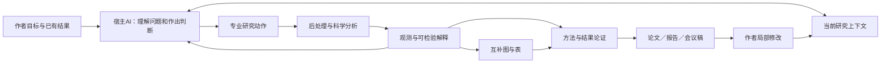

# CFD Research Workbench：从工具集合到协同科研工作流

2026-10-15。作者已批准总体方案及v0.21实施；v0.22–v0.24是滚动研发目标，不是已实现能力。
评估基线：v0.20.0，Git `86d1175`。本轮核对当前代码、既有真实试用评阅及公开一手资料。
本文件承载下一阶段总体方案，后续补充具体接口与任务；不再为每项小改动建立一份平行总计划。

**当前入口（2026-10-18）：v0.22.0已发布，主线/tag为`5846d6c`，PR与主线CI均七项通过。
第14节保留v0.21复评、v0.22计划和实测历史；第15节评估v0.22并细化v0.23正式成稿与作者协作计划。
本次只更新评估与计划，不启动v0.23生产代码、补算、图件重绘或再次发布。**
以上v0.20为总体方案的原评估基线；下文旧开发状态按日期保留，不作为当前待办。

长期研发总则已统一到版本化的`CONTRIBUTING.md`；`docs/ROADMAP.md`只展示当前路线和历史交付。
本地AGENTS只保留当前事实、上述入口和恢复位置。此前完整记录保留于本地历史归档，
旧授权、旧待办和旧科学口径不自动继承。默认只保留研究问题、证据/图件、最终成果三个作者决策点。

## 1. 产品定位与这次升级的判断

CFD-Paper-Agent是宿主AI的CFD专业工具套装。宿主负责理解目标、提出解释、选择分析、评价结果和写作；
工具套装负责让这些判断获得可执行的后处理工具、明确的物理定义、可复用经验和连贯的图文工作区。
面向已有仿真结果，产物可以是SCI候选稿、严谨科技报告或会议论文。强宿主是预期使用条件；
不要求产品自己再托管一个大模型，也不把接入某个模型API当作研究能力。

最近版本的真实收益是数值绑定、时序算子、源码定位和文稿装配更可靠。
但v0.18–v0.20首稿评阅仍为mixed：有局部改善，同时遗漏另一条重要证据或方法定义。
这不足以证明科学质量稳定提升。继续只增加一个算子、一类字段或一段提示词，很难解决根因。

本次建议的质变是：让宿主能完成“发现研究对象→提出可检验解释→按需后处理→比较证据→组织互补图→
写成自足论证→局部更新整稿”的连续工作，并把任务中有用的做法沉淀为工具与技能。
保留已有计算、来源绑定、检索和导出底座；采用逐步接通的改造，避免另起一个脱离现有资产的平台。

**完成标志：**同一个真实研究任务中，材料理解、后处理、机制分析、科学绘图和整稿协作同时变好；
作者与宿主用于转录、拼JSON、复制图件、排查旧值和修复格式的工作明显减少。

## 2. 当前能力与六个根本断点

| 当前事实 | 断点及其实际后果 | 下一阶段处理 |
|---|---|---|
| materials画像、精确检索、Python定义和JSON参数可读 | 文件索引不是有效模型；宿主仍重建caller、覆盖参数、活跃方程及观测定义 | 将这些解释与来源逐步组织成可复用的研究上下文 |
| Fluent/STAR有probe；有限VTK、CSV/NPZ可读 | 原生extract仍抛UnsupportedExtractionError；VTK路径只覆盖有限point scalar | 接通可用后处理后端与统一科学观测，先做一条原生与一条场数据路径 |
| 九类有限声明计算和数值绑定可用 | 区域/截面/通量等常需宿主另写脚本；新问题容易退化为继续加DSL分支 | 形成少量通用物理算子和可运行分析recipe |
| 比较声明与部分时间窗/单位可检查 | “数字正确”不保证观察条件适合机制判断；两条生产路径的科学检查不同 | 共用观测支持与比较定义，把检查结果真正接到图文消费端 |
| 图件导入、有限组合panel和整稿编号可用 | 图像更新不随数值自动重绘；宿主大量搬运图与来源 | 同一分析结果直接驱动图、表、图注与段落的更新 |
| 多节稿件、文献、原生Word表公式已交付 | 文档模型不统一；Word人工编辑不能直接回收；首次科学内容仍依赖一次性手工组织 | 有序文档块、论证上下文与有限作者编辑往返 |

定位依据：`src/cfdpaper/materials.py`、`adapters/native.py`、`adapters/vtk.py`、
`analysis_suggestions.py`、`publication/scientific_context.py`、`publication/table_evidence.py`、
`publication/evidence_panels.py`、`publication/manuscript.py`、`publication/manuscript_changes.py`、
`publication/manuscript_refresh.py`、`publication/export.py`。

特别值得保留的失败教训：两组各自事件前2秒的温度可以都计算正确，但不能直接当作相同受热时长下的比较；
从两个已有温度计算第三个差量，也不等于增加了第三条独立机制证据。
程序应检测明确的支持条件冲突；机制解释与证据的充分性仍需宿主和作者判断。

此外，`docs/architecture/overview.md`仍把一些已经存在的整稿/文献/评阅功能列为future；
本地AGENTS同时累积大量已结束版本记录。实施时应整理“当前能力入口”和历史恢复记录，避免旧文字误导执行。

## 3. 外部经验：借什么，怎样落到本项目

以下为2026-10-15查阅的公开实现或官方工程文档，未在本轮安装、基准测试或集成。
对方的宣传、星数与自报科研表现不作为本项目有效性的证据。

| 参考来源 | 可核对的做法 | 本项目采用方式 |
|---|---|---|
| [Biomni](https://github.com/snap-stanford/Biomni) | 检索辅助规划、代码执行与按任务检索Know-How相结合 | 将CFD方法经验接到实际工具调用；不复制生医工具全集或庞大运行环境 |
| [PaperQA](https://github.com/Future-House/paper-qa) | 将找论文、收集支持片段、生成回答分开，工具可由Agent按需调用 | 每个文献对照保留原句/页位置/支持角色/适用差异；书目信息与科学支持分离 |
| [Agent Skills标准](https://agentskills.io/home)及[K-Dense Scientific Agent Skills](https://github.com/K-Dense-AI/scientific-agent-skills) | 技能可携带脚本、参考和模板，按需加载，跨支持该标准的宿主使用 | 升级现有五项技能；用实际任务测试其选工具和用证据的效果，不堆积技能数 |
| [Anthropic：工具设计](https://www.anthropic.com/engineering/writing-tools-for-agents) | 工具围绕有意义的任务设计，返回有用上下文，用真实多步任务评估 | 将多次重复搬运合为研究动作；返回结果、支持域、图预览与可执行下一步 |
| [Anthropic：上下文工程](https://www.anthropic.com/engineering/effective-context-engineering-for-ai-agents) | 轻量定位符与按需读取结合，避免一次注入全部历史 | SQLite/FTS继续使用；当前问题只加载所需病例、方法、图件及文献片段 |
| [PyVista integrate_data](https://docs.pyvista.org/api/core/_autosummary/pyvista.datasetfilters.integrate_data) | 基于VTK处理point/cell数据积分及面积/体积 | 复用场数据/几何运算；我们负责物理量类型、权重、区域、单位和符号 |
| [PyFluent field data](https://fluent.docs.pyansys.com/version/stable/user_guide/fields/field_data.html) | 可查询表面/变量，读取坐标、法向、连通性及标量/向量场 | 候选原生入口；按实际可用版本和环境实现适配，不猜API或自动迭代求解 |

选择原则来自上述资料，但下面的具体架构是本项目结合代码与失败案例的设计判断。
例如：支持点/单元积分的库并不自动知道某个数组是“W per cell”还是“W/m³”；该区分必须来自物理定义。
技能、代码和工具的许可分别核对，采用时保留署名与必要许可证；本轮不整包搬入外部项目。

## 4. 头脑风暴后的取舍

| 方向 | 预期价值 | 主要代价/风险 | 判断 |
|---|---|---|---|
| 重写成自带大模型与多Agent调度的平台 | 独立运行 | 与用户宿主定位重复，迁移成本大 | 不选为主线 |
| 继续每版补一个算子或提示词 | 局部改善快 | 跨模块断点不消失 | 仅作为完整任务的必要实现 |
| 先做大型GUI/插件市场 | 展示直观 | 容易掩盖科学与数据入口短板 | 后置；先改善宿主操作与成果预览 |
| 科学上下文+可执行分析recipe+共同产物依赖 | 能利用现有资产接通全链 | 接口与真实例子要同步建设 | 推荐的核心路线 |
| 所有主流求解器同时原生接入 | 理论覆盖面大 | 许可、环境、版本验证不可控 | 先统一结果语义，再按实测能力逐个接入 |
| 依靠自由生成脚本解决一切 | 灵活 | 重复造代码、定义漂移、难维护 | 允许受目标约束的recipe扩展，并沉淀常用操作 |
| 全文生成后再集中纠错 | 容易得到完整稿 | 机制和格式错误发现过晚 | 分析→图→段落→全文持续使用共同事实 |
| 一次首稿对照证明模型普适性 | 便宜 | 生成随机性、旧答案泄漏、宿主差异混杂 | 开发回归与留出效果评价分开，报告逐任务表现 |

推荐路线既需要架构整合，也需要科研能力开发；只做一层新CLI或改产品名称不算完成。

## 5. 目标工作方式：宿主决定研究，工具完成可复用动作

用户通常只需提供材料目录、想完成的文稿类型/研究方向、现有软件可用性。
宿主先从材料中查找其余信息。只有无法定位且会改变科学结论的信息才询问作者；
不能要求作者提前填完模型、边界、全部QoI和机制解释，才能启动Agent。

这张图中的回路由真实结果、新问题或作者反馈推动。材料和问题没有变化时，交付后停止；
不自动启动新假设、新求解或无穷自审。

### 宿主接口

优先给已有Python/CLI函数增加一致的高层调用方式，宿主可通过终端直接使用。
支持MCP的宿主可使用薄包装，包装必须调用同一业务函数；不开发另一份计算逻辑。
仅聊天、无文件/工具执行能力的宿主仍使用便携任务包，能力差异如实显示。
现有`providers.py`主要是配置占位；不把填入API key等同已经实现模型接入，也不把实现所有云传输列为首批前置。

高层研究动作建议按以下职责组织，名称仅为设计示意，不是已实现命令：

1. 认识研究：发现案例、字段、有效方法、可用工具与关键缺项。
2. 提取观测：选择区域/截面/时间段，执行可用后处理后端，返回数据及物理定义。
3. 比较解释：形成共同支持范围，计算所选诊断，比较候选解释与观测。
4. 组织图件：从同一结果构建互补panel、source data和caption。
5. 撰写与装配：向宿主提供当前章节事实、文献及相邻主张，组装可编辑全文。
6. 定向更新：源量、定义或作者文字变化后，更新受影响产物，保留其余人工成果。

宿主可跳过已完成动作、并行独立读取，并根据结果返回上一步。计算层不要求固定线性流程。

## 6. 六项核心研发内容

### A. 研究上下文与可理解的多软件结果入口

扩展现有case/scientific_context和adapter，保留项目已有ID，不新增平行“权限/晋升注册表”。
共同上下文包括：几何与工况、实际生效模型、材料与边界、网格/时间离散、结果阶段、可用观测及来源。
源码只读定位与配置/日志/求解器设置交叉使用；无法证明活跃关系时标明未确认，不能从AST自动宣称模型生效。

同一观测必须携带：case、空间位置或区域、point/cell/face关联、物理量和单位、算子/权重、时间基准与窗口、
归一化基准及来源定位。缺项按当前动作是否需要处理，不让一个不相关缺口阻塞所有有效工作。
这些字段先复用已有对象并定向扩展；确需迁移时由主控制定旧输入读取和新输出方案。

入口按实际能力路由：原生API/宏、ParaView/PyVista等后处理工具、中性场格式、已有表格/历史。
首批原生候选是本地真实可用的Fluent；STAR-CCM+/COMSOL/OpenFOAM等随后按可用环境接入相同契约。
没有软件的`.sim`不假装可读；已有中性导出仍可完成相应研究。不要把“识别扩展名”展示成“适配已完成”。

### B. 从有限表格统计升级到物理后处理

首批由真实任务选择以下算子族，不要求全部CFD诊断同时上线：

- 场与几何：已命名区域、截面/线采样、面积/体积分、带符号通量及区域贡献。
- 工况比较：静压/总压、相同流量/泵功/热负荷约束、温度与温差、实际参考状态。
- 时序与事件：共同时间窗、固定时刻、自身事件时刻、保存采样阈值与原生事件分别比较。
- 预算与误差：已有质量/能量项闭合、相对于合适基准的差异；有资料时评估网格/时间步/模型敏感性。

复用VTK/PyVista及求解器工具做几何处理，不重写通用网格引擎。
采样插值与原始离散积分必须分开记录；不得用平滑云图替代守恒量计算。
跨网格、相分率、回流、周期复制、质量/面积权重和积分源项要明确物理定义。
例如单元积分量先求和，体积源密度才乘体积；带回流截面要说明signed/net还是正向通量。

超出内置算子的分析由宿主编写小型可运行recipe。recipe复用数据接口、单位、支持域和结果输出，
保留脚本和必要验证；有价值的重复recipe再晋升为内置功能，避免每增加一项物理量都修改整个DSL。
默认执行已有数据的后处理，不启动CFD求解、调参拟合或写回原生结果。

### C. 机制判别与科学写作真正连起来

对中心问题，宿主按需提出可区分的解释，列出各解释预期出现的观测与已有可用对照。
描述性任务不强行制造两个假说。机制任务应尽量找独立信息来源，而不是把代数重写误当新证据。
先采用已有结果；确需补算时返回具体最小需求和原因，由作者决定。

工具可以检查时间/域/算子/归一化等明确不匹配，返回可用的共同支持范围。
宿主据执行结果判断解释是得到支持、被削弱还是尚不能区分；代码不颁发“因果已证明”标签。
形成简短的研究笔记：主发现、关键数据、候选机理、替代解释、最有判别力的证据、残余问题。
这些内容直接进入图件职责和章节上下文，保护已得到的重要证据不在后续写作中丢失。

写作输出必须体现：图上首先可观察到什么→哪些数值概括该现象→什么物理解释与证据相符→
与文献在什么条件下可比→对设计或研究问题有什么意义。顺序随段落需要变化，不套固定五句模板。
Methods从有效模型与关键观测定义生成可复现正文；Intro的gap由真实研究与文献确定；
摘要/结论从当前主发现更新，避免自动扩大贡献。

### D. 科研图件成为分析的直接产物

升级现有figure contract/evidence_panels和本地脚本，不开发通用画布。
先支持三类真实需要的组合：真实场图+截面/分布；总量+组成/预算；匹配差量+原始状态/事件。
每图回答一个科学子问题，每panel提供互补证据；两点数据可用正文/小表，不强行铺满主图。

统一工况颜色/marker、单位、共享色棒语义、图例和实际论文插入尺寸。
既检查绘图bbox，也检查最终Word/PDF大小下的可读性，覆盖缺字体回退、复杂单位、长label和灰度。
source data、脚本、SVG/PDF、PNG/TIFF、图注与论证用途一起交付；无需每次人工搬运。

数据图使用真实结果；概念示意图可通过已有外部绘图技能生成可编辑SVG/draw.io。
已有真实场图允许组合标注，不用生成式图像替代流场。
沿用P04的本地脚本优先规则：用户精修的脚本/图件是更新入口，模板不能覆盖人工样式。

### E. 统一整稿、正式格式及有限作者往返

将当前分列paragraphs/figures/tables/equations规范化为内部有序块，保留已有token、MathNode与来源ID。
块有稳定ID，以支持图表靠近引用、章节移动、批注定位和局部修改；不让段落序号承担长期身份。
复用现有Word输出；Markdown/LaTeX逐步消费同一结构，不再让旧文本导出与新科学稿各自扩展。

首批落实三种文稿职责profile：SCI研究稿、工程报告、会议论文。科学事实共用，篇幅、章节、前置内容和模板不同。
先选择可取得的真实模板验证Word及一个LaTeX会议模板，不建设庞大期刊模板库。
正文默认两字符首行缩进、段前后0pt；标题/图注/表格独立样式，明确模板另有要求则随模板。
原生公式、跨页表头、数值对齐、文献、图注和实际页面应共同验证，不能以DOCX生成成功验收。

作者往返先覆盖正文、图注和批注：以生成基线、作者稿、新候选三方差异回收修改。
绑定值、公式、引文域或复杂结构冲突呈现具体选项；不承诺任意Word无损往返。
普通语言精修不应要求作者回头修改JSON。确认过的人工段落和图样式必须在后续更新中保留。

### F. 联动、技能和日常使用

把已有依赖关系扩展到：来源→计算→图件/表→具体论断→段落→摘要/结论。
这是现有状态中的依赖边，不引入图数据库或多份事实库。
源变化时重算必要量、调用登记的当前图脚本、更新表和数值，再将改变意义的段落交给宿主定向改写。
无需把整篇论文重新生成。定义变化比数值变化更重要：例如area mean改成mass-flow mean必须触发解释复核。

现有五项技能继续作为入口：

| 现有技能 | 升级重点 |
|---|---|
| cfd-paper-workflow | 理解目标、按能力选择工具、继续当前研究任务、控制单轮范围 |
| cfd-evidence-intake | 案例与有效方法恢复，多软件提取及冲突定位 |
| cfd-qoi-physics | 比较设计、物理算子、竞争解释与证据判别 |
| cfd-figure-production | 分析到互补图、真实场图组合、实际尺寸、作者本地精修 |
| cfd-evidence-writing | Methods自足性、图文论证、文献角色、整稿一致性和真实意见响应 |

每项技能包含短操作说明、实际工具入口、成功例和失败修正例；重资料按需读取。
P04经验放入适用的参考/recipe，不把燃烧器术语写死公共核心。
自审、真实返修复用当前记录与块定位；只在真实审稿事件到达后处理回复，不抢占本轮后处理和写作主线。

## 7. 一项能体现升级效果的完整试用

给宿主一个已有冷却结构项目目录及目标：“判断两种结构在可比运行条件下为何换热表现不同，形成论文候选稿。”
作者不先提供QoI表、机制答案或所有参数清单。产品应支持宿主依次完成：

1. 查明工况、结构、热负荷、流量、网格/近壁处理、可用场与报告；区分真实共同条件与猜测。
2. 提出当前资料能够回答的研究问题，若同流量与同泵功结论不同，明确选用的比较条件。
3. 从现有场/面结果提取压降、能量收支、区域贡献和必要截面，不只读取预填好的最终CSV。
4. 区分“总换热增强”“流量再分配”“热点位置变化”等可能解释，执行有判别力的现有对照。
5. 输出相互支撑而不重复的图件，撰写自足Methods、发现与机制讨论，再形成全文。
6. 作者改一段解释和一处图样式；随后源参数或量定义变更时，相关图文能更新，其余人工修改保留。

现有本地项目大多已用于开发。它们适合回归和首次新问题试用，但不能换名当陌生项目盲测。
本轮计划不重跑这些项目的仿真；原生路径的运行环境、许可证及当前数据能否读到，在实施第一批确认。

## 8. 旧资产的实际职责

| 资产 | 本次要迁移的能力 | 不能如何使用 |
|---|---|---|
| P04 Fig.5与场观察 | 先读场形态，再用定量诊断解释 | 不仅复刻一张Fig.5或恢复旧代表体积换算 |
| P04 Fig.9/10/11 | 贡献拆解、非均匀截面、局部与整体证据的职责 | 不把采样峰当连续场极值或局部物种当性能排名 |
| P04 Fig.12–14与整稿/返修 | 多图机制、跨工况、主稿/补充证据分层、术语传播 | 不复制内部审计腔与过量防御正文 |
| P04作者手改和引用事故 | 本地脚本优先、用户段落保护、文献身份与定位 | 不把旧AI稿覆盖人工稿 |
| 散热完整A–F外评及后续试用 | 壁温/加权/面集定义、物理图件和正式排版 | 不只用JSON摘要代替外评全文，不假定原验证缺口消失 |
| 电池v0.17–v0.20试用 | 有效模型、同钟/事件支持、独立观测、Methods完整性 | 不把控制模型的保存时序自动算作广义多相CFD验证 |
| Gate5/SG_Baffle | 不可比、错误单调、弱收敛、虚假批准的负例 | 不把旧失败报告或新增状态字段当已修复 |

查找从已有资产矩阵开始，按当前任务定向读取原材料。P04最终接收口径为cell-integrated Heat of Reaction（W per cell），
严格HRR诊断另算；本次规划不改动冻结论文或原仿真资料。私有语料不进入公开示例或GitHub。

## 9. 已批准的多版本实施顺序与分工

资源目标沿用55%科学、25%图文、10%适配易用、10%必要可靠性；按任务投入判断，不设置代码行数比例门槛。
主控统一接口和整合；最多三条并行支线，接口确定后各自拥有清晰文件范围。

| 阶段 | 主要交付 | 达到什么才继续 | 并行方式 |
|---|---|---|---|
| M0 当前架构归一 | 一张真实能力图、复用接口及实际任务输入、缺陷优先队列 | 确定首条后处理路径和共享观测/动作/文档块扩展，不重复大篇幅规格 | 主控；A核对科学入口，B核对图文接口 |
| M1 第一条完整研究链 | 材料识别→现有结果提取→共同条件比较→互补图→方法/结果/讨论 | 一个真实任务由宿主连续完成，主要机械映射由工具生成；已知时间支持错误能被定位 | A后处理/科学，B图文，主控宿主接口 |
| M2 科学与图件扩展 | 场/区域/通量recipe、机制判别、图件与全文变更联动 | 覆盖稳态传热与已有瞬态任务；旧重要证据不被新图替换掉 | A物理recipe，B组合图，C独立任务评价 |
| M3 完整交付协作 | 有序文稿、SCI/报告/会议profile、有限Word回收 | 实际模板/页面合格；一次作者改稿和源变更共同完成，不损坏其他内容 | B文档，A科学回归，主控共享更新逻辑 |
| M4 效果与发布 | 留出任务、第二宿主试用、完整安装示例与说明 | 科学、用户成本、图文联动都有实际收益；原生/中性路径能力如实列明 | C评价，主控发布；其他支线只修真实问题 |

M1就必须使用现有全文装配路线，不等所有适配器做完才开始写论文。
M1本身是可以独立试用的最小成品：一个真实场数据任务、一条实际可用后处理路径、一种Word研究稿、
一次源数值变化后的图文更新。直接复用现有装配；有序块迁移、三种profile和Word回收均不作为M1前置条件。
M2和M3可在接口稳定后并行；不拆出长期常驻“治理支线”。
主控独占共同依赖、稳定ID和更新协调：A/B中的分析图件任务负责“结果→图件产物”，
文稿任务负责“文稿块→导出/编辑回收”。两端不能同时独立改造整条更新链。
每阶段交付能打开、能用的成果，向作者报告新增能力、实测表现、真实不足和下一步。
这次整体升级以Research Workbench为共同目标，分为下述四个完整能力版本。
M0是必要准备，M4是实际评价，不各自变成治理版本；不能因为又补完一个字段就宣布整个升级完成。
如原生环境或新案例不足，必须缩小公开能力声明，不用版本号营造已经通用成熟的印象。

### v0.21：贯通研究工作流

从现有散热场和方法定义开始，交付案例/比较恢复、真实数组后处理、互补图、Methods/结果/讨论和
现有全文装配的一条连续链。作者不必提前给出完整QoI表、JSON或机制答案。观测定义、稳定身份、
最小依赖和人工资产保护不能后置：源数值改变时重算/重绘相关产物；解释变化交给宿主处理。
作者稿不覆盖，候选另存；冲突具体呈现。沿途修复单位、字体回退、颜色单独区分和表格对齐。
验收包括真实研究稿、一次源数值更新、无关内容不重写、当前作者本地脚本优先，以及实际Word/PDF。
不把完整Word回收、全部后端、全部诊断或三套文稿profile列作本版前置。

### v0.22：物理诊断与机制论证

按研究问题交付场/区域/截面/积分/带符号通量、预算与模型/离散对照、共同时间及事件支持。
区分代数重写、同解互补诊断、模型/条件对照和独立验证。宿主选择真正有判别力的已有证据，
而不是添加指标凑深度。至少接通实测Fluent只读路径和中性场路径；环境在v0.21先确认。
实现真实场+分布、总量+预算、原始状态+匹配差量三类互补图；近邻文献保留片段、位置和用途。
首稿必须改善证据选择和机制讨论；原生环境未验证则该项未完成，但不阻断其他有效科学工作。

### v0.23：正式成稿与作者协作

统一有序文稿块并保留既有token、MathNode和来源ID；DOCX/Markdown/LaTeX共用事实。
落实SCI、科技报告、会议论文profile，以及实际Word模板和一个LaTeX会议模板。
正文两字符缩进、段前后0pt，标题/图注/表格独立；模板明确要求优先。
正文、图注、批注实现有限三方回收；公式、引文域和结构冲突不能静默吞掉。
数值变化与定义变化分别处理；后者必须进入相关解释复核及摘要/结论更新。
验收是一轮作者改文/图、源量/定义变更、局部更新、人工修改保留、实际正式导出的完整协作。
不承诺任意Word无损往返，不以XML成功代替真实页面。

### v0.24：可携带的科研工作套装

统一业务函数外提供薄MCP入口，不复制逻辑；相对路径项目、环境说明、上下文、成果和恢复位置可搬迁。
五技能按需载入实际工具、成功例和失败修正例。在第二个实际宿主完成任务与恢复，分别评价接口和科学效果。
用单相内流/压降、共轭传热、真实瞬态或多相三类任务评价适用性；原生与中性路径需实际证据。
电池控制模型只承担其真实时间/方法回归职责，不能冒充多相CFD验证。
缺少真实异构项目则该成熟性目标未完成，不以合成例子、旧答案或版本号补足；公开声明仅覆盖实测范围。

每版结束回写：兑现的能力、实际阻塞、不必要任务及下一完整任务。允许改变实现顺序和后端，
不得悄悄删除未完成科学/格式/协作要求。普通修复并入能力版本，紧急缺陷可发补丁。
主控加最多三条短期支线：科学/适配、图文/文档、成果节点的隔离试用；不常驻满负荷。

## 10. 小毛病如何同时闭合

把缺陷挂到受影响的主链任务，不另做没有尽头的全库审计。

| 已有证据支持的问题 | 归属 | 修复证明 |
|---|---|---|
| 源量更新后图像仍旧 | M1/M2 | 改源值，相关图源数据/图/图注/正文同步，未涉及图不动 |
| 同刻与own-event比较误用 | M1 | 在计算和主张使用位置定位冲突，能选已有共同时间支持 |
| 方法定义可定位但正文缺关键边界算子 | M1/M2 | 首稿读者能重建任务所需方法，缺项具体且合理 |
| reference/source定位不准确 | M2/M3 | 对照实际页/段验证支持句，书目不混入内部说明 |
| 颜色单独区分、单位caret、表格与正文样式 | M1/M3 | 实际页面可读、物理量显示正确，保留作者样式 |
| 手改稿无法继续使用 | M3 | 正文/图注一轮受控回收，冲突不静默吞掉 |
| 架构/限制文档过时，历史恢复入口太长 | M0 | 当前入口与实现一致，历史仍可检索，停止条件不相互矛盾 |

普通大图放不到剩余页面所产生的留白不自动算bug；先看实际页面，再决定排版。
发布CI继续验证平台和包，但测试数、输出文件数、页数或红色报告数量不是科研质量指标。

## 11. 验收：证明工具套装变强，而不只是把样稿改好

### 对照设计

开发期间用已有P04、散热、电池及Gate5失败模式做定向回归。
正式效果评价使用未给旧稿/答案的新问题，尽可能再加入一个真正未用于开发的项目。
M0就选定评价任务及成本计数口径，将答案与旧评阅隔离于开发写作者；M4才运行最终留出评价，
不能等实现结束后再挑最有利的任务。若没有合适的新项目，M0即登记这个范围限制。
若只有已知项目，就明示测试身份，不因换一个任务名宣称领域泛化。
基线v0.20与候选使用相同材料、宿主型号/能力和任务预算；记录实际首稿，不覆盖失败稿。
小样本先看具体效应与遗漏，不用单次胜负声称统计显著或全模型提升。

最低评价集合为：一个真实场数据的完整研究任务，一个已有瞬态判别任务，一个作者改稿/源变化任务，
再用Gate5的已知负例验证不可比/缺证处理。完整稿只在最终集成后集中评价一次；
日常使用小型分析/图文回归，避免每改一个字段重写整篇论文。

### 建议的验收标准（设计目标，尚非实测成绩）

- **科学正确：**已检查关键数值、单位、case/空间/时间支持无硬错；不支持的因果、连续最优和验证声明不得出现。
- **理解与深度：**关键方法定义完整；中心论断使用互补证据，并处理真正相关的替代解释与近邻文献。
- **实际自动化：**宿主无需逐文件拼装完整证据JSON或重复转录数值；工具完成所宣称的提取、计算和更新。
- **使用成本：**记录人为转录、修复配置、临时glue脚本与作者干预；以v0.20同任务为参照，机械干预减少约一半为初始目标。
- **联动：**至少一次源数值变化、一次定义变化、一次作者文字/样式修改均能定向处理，不丢未改成果。
- **图文质量：**图件的信息职责成立，最终插入尺寸可读，实际Word/PDF无硬伤；SCI/报告/会议profile兑现实际交付。
- **可携带：**至少两个实际宿主环境走通相同接口；至少一条实测原生后处理与一条中性场路径。接口可用不等于科学水平相同。

评阅分开评价软件功能、宿主实际使用、科学论证、视觉与作者成本。
机械干预按具体操作计数，例如逐值转录、重复对象映射、资源复制和布局修补；科学问题选择、
机理判断和必要作者决策不算应消灭的机械成本。作者时间、宿主工具调用及token成本分别记录，不混为一个分数。
允许报告局部mixed，但若中心能力仍没有改善，不能只凭CI全绿把整体升级判为成功。
独立评阅只在约定的完整成果节点进行一次；有明确问题再定向修复，不进行无限自评分循环。

## 12. 范围、风险与当前下一步

本轮设计不包含重新求解CFD、自建通用Agent运行平台、自动投稿、训练基础模型或全量期刊模板库。
多软件支持靠能力查询、成熟后端和共同科学语义逐步实现；受许可/版本限制的路径先说明实际可用范围。
开源数据处理不能保证底层模型验证，新颖性也不能靠文风生成。证据不足时交付有明确下一步的研究报告，
不因目标写着SCI就制造可以投稿的结论。

主要实施风险是公共科学定义同时影响分析/图文、有限Word回收的真实复杂度，以及原生后端测试环境。
处理方式是先跑M1完整链，再扩展；共享接口由主控维护，支线围绕实物验收，不先冻结数千行伪实现代码。

## 13. v0.21当前实施批次（2026-10-15）

作者已批准持续实施到真实任务交付和一次定向刷新，再作阶段评价，不要求逐步重新批准。
只细化当前版本；后续版本不提前编写数千行伪实现计划。包版本保持0.20.0直至实际完成发布准备。

### 首个任务与评价设计

选择已知散热项目H30的两结构×两热点位置、四组Si/TIM界面真实面温度。原始面值、真实面积、
顶点/连接关系和提取定义齐备；不混入全硅外表面峰温，也不运行原科研脚本或仿真。
这是已知项目的新工作流试用，不是陌生项目盲测；v014完整稿和科学答案不交给隔离首写者。
输入具体位置、来源定义及执行记录保存在私有`.cfdpaper/v021/`；公开测试使用构造小面网格。

v0.20对照冻结为同一输入、宿主设置和范围下的操作链；首次稿不被反馈修订覆盖。
记录转录、重复映射、复制资源、临时glue与布局修补，不把科学判断计入机械负担。
此轮可测软件/作者成本与已知项目科学表现，不能自动完成陌生项目或跨模型通用性评价。

### 实施任务与所有权

| 顺序 | 实际交付 | 所有者 | 验证 |
|---|---|---|---|
| T0 | 总计划/长期总则/公开路线归一，完整保留历史 | 主控 | 内容与链接；不重跑旧版本 |
| T1 | 真实面值与面积的阈值分布，沿用既有加权统计/结果绑定 | 科学支线 | 不等面积、严格/包含阈值、尺度不变性、原始索引 |
| T2 | 原多边形共色标场图+面积阈值分布、source data、可编辑导出 | 图文支线 | 共定义计算、几何对齐、实际插入尺寸与人工预览 |
| T3 | 当前本地图脚本配方、只执行受影响产物 | 短期更新支线 | 源/脚本变化、无关产物保留、失败不污染基线 |
| T4 | 共享观测声明、准备/写作/刷新Python与CLI接通 | 主控 | 新工作区、结果→图/表/值、定义变化与人工保护 |
| T5 | 真实四场研究稿与隔离源变化；针对性相关回归 | 主控整合/隔离宿主 | 实际科学读法、Word/PDF、成本与剩余缺口 |

首次链最低科学定义：face温度K、面积m²、Si/TIM界面、保存稳态结果、真实面积加权；
阈值为分布诊断而非安全/失效阈值。场图直接绘制面多边形，不用质心插值替代真实场。
Fluent v231可执行文件路径存在；未启动、未验证许可证，不能据此宣布原生提取完成。

### 2026-10-16 实际结果与阶段判断

T0–T5的本地实现和首次真实任务已经走通。新增 `research --study` 准备工作区、
`research --workspace` 构建候选及 `--baseline` 定向刷新；仍使用既有计算、数值绑定、
跨节证据和Word装配，不另建事实库。完整私有输入、两版首次输出和实际成本保留在
`.cfdpaper/v021/`，恢复入口为该目录的 `PROGRESS.md`。

| 验收面向 | 本轮实际证据 | 仍需明确的边界 |
|---|---|---|
| 真实数据→研究稿 | 四组原始面值/面积/多边形，经产品计算与绘图，宿主撰写四节短稿；1张原生表、2幅互补图、3个编号公式 | 这是范围适中的研究短稿，不是完整SCI稿或新的模型验证 |
| 科学正确与方法自足 | 独立算术核对均值、空间标准差、严格超阈面积；稿中说明面关联、物理面积、完整界面、稳态支持与阈值定义 | 缺少本任务的网格/收敛/实验验证，未宣称已补齐 |
| 科学读法 | 首次稿用场图与交叉的面积分布解释“均值与非均匀程度不是同一排序”，并保留导热/冷却路径不能唯一分离的限制 | 两版宿主都得到这一核心读法，不能据单次比较宣称科学发现能力跃升 |
| 图件与正式输出 | 原面片共色标图、精确阶梯分布、可编辑SVG/PDF与PNG/TIFF、source data；4页DOCX/PDF逐页查看，未见裁切遮挡 | 有正常留白和自然跨页；未完成跨渲染器/跨平台版面验证 |
| 数值与定义刷新 | 在隔离副本分别施加明确标注的软件测试扰动和阈值变化，图、表、表头、绑定文字同步；作者脚本与原草稿保留 | 扰动不是新增CFD结果；叙述可能随趋势反转失效，系统明确要求宿主解释复核，不把只换数字当作科学更新完成 |
| 无关成果保护 | 配方级选择执行、未变产物跳过、源文件与作者草稿保护的测试通过 | 同一配方内部可重绘整组互补图；尚非任意Word对象的三方合并 |
| 实际使用成本 | v0.20需临时实现面图/超阈统计和四节装配映射；新链由产品承担这些步骤，宿主仍负责选论点、写正文与数学表达 | 两版都能避免硬抄统计数值；本轮未测得可靠token/工时，不虚报“节省一半” |

开发中发现的真实问题也保留在记录中：早期准备模板把首个均值当作临时主张，已改为
方法定义占位并明确交给宿主选论点；阈值原为静态表头，已改成可传播绑定。
首次试用遇到一次模板元数据同步，未将它隐藏为无成本。大型面索引在写作上下文重复展开的问题
按展示层做定向压缩，完整来源明细仍按原文件定位读取，不改计算值或原始证据。

最终本地回归为2421通过、2跳过（未安装可选Pandoc）；Ruff检查/格式及差异检查通过。
临时隔离wheel构建、checkout外安装导入、新命令和技能打包检查通过。它们不替代上述科学和页面检查，
也不代替发布所需的平台CI。写作上下文从10,143,176 B缩至83,087 B；36个完整明细指针实际回读有效，
原结果与首次上下文未被覆盖。该缩减量是具体上下文文件体积，不是token/工时节省率。
当前仍处于 `workstream/v021-research-workbench`，包版本保持0.20.0，未发布v0.21，未启动v0.22–v0.24实现。
原始科研数据、历史首稿与用户修改未变；本轮P04复用为已确认的方法/图文协作经验及既有回归，
不是重新宣称完成P04盲写或真实跨项目验证。

### 下一执行点

本批在真实任务交付和刷新后的阶段评估收口。发布准备沿用现有CI/打包流程；不再次重做首稿。
后续v0.22优先用真实热通量/区域对照区分可能的传热解释、实测一条原生提取，并处理已有时间支持问题。
有限Word回收、文稿profile、第二宿主和陌生项目评价保持原版本顺序，不以当前试用代替。

### 2026-10-16 作者追加：机制图 Studio 接入

按作者要求，将 `paper-framework-figure-studio-pro` 接入现有 `cfd-figure-production`，
不另建第六套绘图工作流。`figure --task-input` 对 schematic/hybrid 任务实际输出
Studio 路由与论文理解、核心机制展开、图—图注协同指令；已安装时使用该 Skill，
未安装时使用随任务包和wheel携带的精简适配参考及MIT-0许可。

沿用既有准备/导入接口，新增可选标题、图例和正文引用句并随交付保留；默认仍要求真实可编辑源。
纯概念 schematic 可显式选择 `raster_concept`，允许宿主图像模型完成最终机制插图，
但准确报告无可编辑源，不能包装成可编辑SVG。定量图、混合图的数据层和真实CFD场仍由
原始数据/绘图脚本生成；不让图像模型重造数值、云图或色棒。

默认只完成一幅图和一次针对性图文核对，不移植多阶段审批、多候选批量生成或历史产物删除。
原P04/散热图、原始材料和作者精修不变。本轮实际验证为96项相关测试通过（含12项新增）、
Skill结构校验、Ruff及wheel内代码/参考/许可检查通过；未重跑此前2421项全量测试，
未执行新的真实机制图质量对照，不据指令/软件通过宣称视觉或科学质量已普遍提高。
本项留在v0.21开发分支，未改变包版本或发布状态。

### 2026-10-16 同日续作：散热实图与正文衔接

在既有四工况散热任务上完成真实 Studio 试用，而非仅验证指令路由。依据实际界面场、
面积分布与方法定义，生成一幅“热点迁移—分层传热路径—界面响应”三面板概念图。
首张图有不应出现的硅层凹陷，经一次定向编辑修复；首图保留，不掩盖生成模型的几何失误。
新图作为 Figure 3 接入 Discussion，正文引用、图注和373.15 K阈值绑定随现有装配统一解析。
新增 `attach_imported_figure` 复用接口，不再要求宿主手动搬运全部图件并修改多份文稿JSON。

实际交付是5页Word/PDF研究候选稿，五页已查看；原2幅定量图、数值表、原正文及作者绘图脚本
保留，原图配方本次显示 unchanged。71项直接相关回归通过，新增API覆盖插入、全局编号、
图注引用、DOCX宽度、原稿保护及错误输入。没有以文件成功代替科学或视觉检查。

实测支持的改进是：以论文材料指导概念图，并贯通正文、图注和正式文稿。
当前机制图为1611×976位图，160 mm宽约256 ppi；可审阅但不是可编辑SVG或完整出版终稿。
温度证据仍不能分解导热与冷却贡献；高温面积下降不等于峰温下降，也不适用于任意阈值。
本次已知任务试用不能证明相对旧版的普遍质量优势。源结果变化后的概念箭头须由宿主复核。
未改变v0.21未发布状态，未扩展v0.22范围。

### 2026-10-16 正式开发续批：可调用、可搬迁、可公开运行

在上述已完成的真实任务上补齐日常使用入口，不重做首稿或另建流程：

- `research --attach-figure` 将已导入的机制图、图注和正文引用插入指定章节/段落，
  默认另存工作区；随后由普通 `research --workspace` 构建。不再需要宿主临时写接图代码。
- 新增可公开运行的 `examples/surface-research/`，从六个不等面积原面及两组构造温度场
  到互补图、原生表和四节Word短稿。示例明确是数学构造，不冒充新的CFD验证。
  `--prepare-only` 保留由宿主选论点和撰写的真实入口；文稿不是模型自动发现的科学结论。
- 修复定义变化的传播显示：只有阈值/方法变化而均值未变时，受影响的机制图及图注
  也进入正文解释复核清单。图像和作者段落保留，不自动改造机制箭头。
- 在仓库外用安装后的wheel代码实际接图、构建，并完成工作区迁移后的阈值刷新。
  均值/标准差不变，阈值表头和相关图文更新，作者草稿未被改写。依赖来自现有开发环境；
  全新依赖环境及Windows/Linux矩阵仍交由原发布CI验证。
- 增加安装包公开示例CI步骤。实际Word检查发现窄长面色棒过长、画布留白过大，
  已在默认绘图器修正；保持160 mm图宽、字号、数据和坐标，仅适配色棒并裁去纵向空白。
  既有散热图与作者本地脚本未覆盖。

本地全量回归2459通过、2个可选Pandoc测试跳过；此后仅对排版修复运行44项相关测试，全部通过。
Ruff、格式、差异及CI YAML解析通过。最终开发wheel重新构建并在仓库外重放公开示例；
实际Word导出PDF三页逐页查看，图表/图注无裁切遮挡，正文保留两字符首行缩进与段前后0 pt。
三页为该短稿自然分页，不将这一构造示例称为投稿论文。临时构建保留版本0.20.0，不能当作正式发行。

当前下一步是v0.21整合与发布验证：保持本轮真实稿、公开示例和定向刷新结果，
按原CI完成支持平台/安装验证及版本发布准备，不再次重写科学首稿，也不提前实现v0.22。
本轮工作区修改未提交、未push/tag，v0.21仍未发布。

### v0.21.0 发布集成（2026-10-16）

作者已明确授权完成版本整合、跨平台验证并正式发布。本节取代上面的开发状态，
但不改变已经记录的首稿、反馈修正及科学局限。版本入口、引用元数据、CLI及安装包
同步为0.21.0；[发布说明](../releases/v0.21.0.md)集中描述实际功能和使用方法。
使用现有Windows/Linux、Python 3.10–3.12矩阵及独立wheel安装示例验证，
通过后方可创建正式发行。最终发行状态以GitHub对应tag、Release及CI结果为准。
本地恢复记录保留实际提交与运行位置，不把旧的“尚未提交”状态继续作为当前待办。

后续顺序仍为v0.22物理诊断、v0.23正式成稿与作者协作、v0.24可携带工作套装；
本次发布不重新生成真实科学首稿，不扩大原生求解器或跨模型能力声明。

## 14. v0.21目标复评与v0.22实施计划（2026-10-16）

本节是当前下一版本的执行依据，不替换前述长期目标和历史记录。2026-10-16形成评估与计划；
2026-10-18复核时本地已有研发候选，尚未完成真实任务、整合和发布验收，具体见14.7。
v0.21.0正式发布基线仍为main/tag `5794cad`。复用既有首稿与有效CI记录，不重跑旧任务。
投入仍按55%科学、25%图文、10%易用、10%必要可靠性分配。

### 14.1 v0.21是否达标

结论：**限定真实任务中的核心工作流目标已经兑现；材料自主理解、机制解释提升和效率幅度尚未全部证明。**
它是可用的完整小成品，不是只有接口的基础设施；但不能把工作流贯通等同于科学研究能力已经成熟。

| 原定目标 | 当前证据与判断 | 后续处理 |
|---|---|---|
| 原始场数组→物理分析→互补图→研究稿 | 已完成四组真实原面温度、面积统计、场图/分布、表格、四节Word；不是仅读取最终指标表 | 直接复用，不重建 |
| 方法和图文可理解 | 已交付必要面关联、面积、域、时间支持与阈值定义；真实4页及接机制图后的5页稿已查看 | v0.22补充新诊断定义，不重写已充分的方法 |
| 数值/定义定向刷新、人工保护 | 隔离数值与阈值变化能更新相关结果/图/表/绑定值；作者草稿和本地图脚本保留，受影响解释被定位 | 复用依赖链；变化后的机制仍由宿主重判 |
| 跨平台和安装使用 | Windows/Linux、Python 3.10–3.12及安装包示例通过，正式发行完成 | 不把软件CI当作跨平台Word视觉或科学验证 |
| 给普通材料即可恢复研究任务 | 部分完成：本次由主控先整理study定义及四个NPZ，再验证产品链；尚未证明宿主可从未整理目录恢复全部模型/观测 | v0.22在同一任务中读取已有方法与报告，减少预填，而非另建万能材料识别平台 |
| 科学深度与使用成本改善 | 已减少临时面场处理、资源复制和文稿映射；但v0.20和v0.21均找到相同核心读法，未记录可靠工时/token | 不宣称机制发现跃升或节省50%；下轮评价证据利用与机械干预的实际变化 |

v0.21保留的解释缺口是温度分布只能描述响应，不能分开量化固体导热与冷却路径。
Studio图已贯通正文、图注和编号，但仍是概念解释，不是新通量证据或最终可编辑出版图。
任意Word三方回收、三种稿件profile及第二宿主验证仍按v0.23/v0.24推进，不倒灌到v0.22。

### 14.2 下一版围绕一个真实问题，不堆指标

主任务延续现有两结构、两热点位置的四组稳态结果：

> 相同热负荷和流量下，热点位置与结构为何使局部温度、整体均温和高温面积不同向？
> 已有及可只读提取的区域热预算、侧向导热和冷却排热，能把这一解释推进到哪一步？

资料复核发现，问题不是原项目完全缺少证据，而是v0.21任务包没有充分接入：

- H30已有热点投影/其余界面的区域温度与面积，可以解释区域均温变化怎样组成整体均温变化。
  **随热源移动的热点区**与**固定物理位置上的差量**是两种观测，不能互相替代。
- H26/H33已有偏置工况的界面热流、局部热预算及分高度导热路径。先接入已有数组和定义，
  不要求作者重新整理成最终QoI，也不重新生成这些历史结果。
- 中心两场已有CASE/DATA和面温度；本轮定向检查未找到相应完整界面热流/侧向预算导出。
  最小新增工作是从这些已有解中按相同定义后处理，不是新建或重算工况。
- H33侧向导热来自版本限定的温度梯度重构积分，不是原离散方程的保守面通量；
  与界面收支余量对照有价值，但共享同一CFD解，不构成独立实验验证。
- 旧A–F外评针对另一流量/均匀热源任务的壁温定义、出口CV稳健性和横向焓输运问题，
  不因H33存在而自动闭合。仅复用其定义辨别、区域解释和成稿尺度教训。

中心问题允许得到“某解释被支持/削弱/仍不可区分”的结果，不预设必须证明混合增强、
局部换热系数提高、面积无关拓扑收益或某结构最优。先用现有证据完成有效分析，
只有关键解释仍需区别时才选择一组连接截面的质量/焓输运；新求解不属于本版默认工作。

### 14.3 三条能力增量及科学定义

**A. 从真实场到区域、路径与预算。**

保留适配器`probe/inventory/extract`、既有计算声明与`result_ref`。原生Fluent当前仍是
识别文件并建议导出，尚无产品提取；旧科研项目已有只读PyFluent/v231后处理经验，可定向复用。
先实现本任务需要的zone、原面几何、温度、热流和报告读取，再按实际缺项支持材料限定截面。
不整份运行含旧绝对路径的科研脚本，不建设通用网格引擎。读取既有解不迭代、不保存回原件；
若需内存梯度重构，明确版本与算法，不能伪装成直接读取保守通量。

中性路径优先扩展既有原面NPZ及随附定义，读取同一真实导出的标量/向量与几何，进入相同计算。
当前VTK只支持点标量；仅当选定输入确有VTK需求时补cell/vector关联，不把完整VTK适配作为平行项目。
库/后端选型复用已有依赖与成熟处理工具，实际新增依赖时再核对版本、许可和安装要求。

最少统一的定义直接扩展现有观测，不新增事实库：case/比较角色、材料与空间域、点/面/单元关联、
原生元素位置、量与单位、算子和权重、法向/符号、时间/事件支持、参照及提取方法。
共同条件只约束本次比较声称固定的量；不禁止结构和热点位置这些设计变量变化。
未读取到的条件保留未知，不能由相同文件名或数组长度推定一致。

| 诊断 | 必须区分的物理含义 | 对应图文用途 |
|---|---|---|
| 区域温度/超限面积 | 随源区域、固定坐标区域；面心归属或真实裁剪；面积权重和边界部分面处理 | 解释局部与整体变化，不由分布曲线倒推出某坐标处变暖 |
| 同位置场差量/截面/线采样 | 关联位置与几何匹配；不同网格不能按行号相减；展示插值与原始积分分开 | 定位哪里改变，展示场与分布的互补关系 |
| 面/体积分与热流 | W每面/每单元直接求和；W/m²乘面积；W/m³乘体积；向量通量须与有向面积点乘 | 杜绝重复乘面积/体积与无方向速度模充当输运 |
| 带符号路径 | 同一控制体外法向、正向/反向/净量；wall/shadow不重复计入 | 净值不掩盖相反方向的交换；不将绝对值总和当净排热 |
| 区域预算 | 输入、输出、源项、储能、残差各有定义；稳态储能为零须有状态依据；分区不重叠且覆盖被声称的域 | 展示热量去向；预算余量不能再充作独立实测路径 |
| 方法/模型对照 | 先对齐case、域、算子和条件；梯度重构与原生预算分别保留；差异与待解释效应同尺度比较 | 细微排序若未超过相关方法差异，只保留可支持的方向或数量级 |

局部导热预算不等于整个冷却器能量验证。质量/焓流若被选用，另需材料筛选、速度方向、密度、
焓定义/参考及截面；现有未筛选材料的速度模切面不能直接承担该诊断。

**B. 让宿主选择可区分解释的证据。**

利用现有scientific context、interpretation、章节职责和claim映射，提供精简的任务上下文：
研究问题、具体观察、可检验的解释、各解释预期的诊断、实际结果与尚不能区分之处。
这不是新注册表或强制五段模板；宿主负责研究判断，产品负责提供并检查可用支持。
区域面积与平均热流已有时先用它们解释积分量，不能把所有机制不足笼统转为“需要更多数据”。

证据角色明确为代数重写、同一解的互补诊断、条件/模型对照、独立实验或外部验证。
`Q=A·q_mean`分解可解释组成，但不自动分离因果贡献；梯度积分与预算余量可相互检验，
不能凑成两个独立验证。已有网格/模型报告只支持它实际比较的QoI，不替所有新区域指标背书。

既有电池探针只承担一个紧凑的时间支持纠错任务：同一物理时刻、共同窗口、各自事件相对时刻、
原生事件与保存采样越阈分别保留。own-event比较本身合法，但不能用于声称等曝光时间的排他机制。
误用应在比较结果、图注和论断消费处被定位；用已有共同样本修正，不重建瞬态模型、不默认插值或补零。

文献继续使用现有身份、支持片段、locator和role。新增核对的是片段是否确在指定页/节/行，
不是只在全文中能搜到；PDF页面序号与印刷页码明确区分。局部检索无法确认位置时返回具体缺项。
不为充实篇幅强制加文献；有比较时说明与本任务模型、条件、观测的对应关系。

**C. 新诊断直接进入图、图注和正文。**

沿用v0.21研究稿、结果绑定、配方及刷新，只补附加诊断的接线和缺失图型。
三个图族按信息职责选用，不按图数凑版本：

1. 原场＋区域/截面/分布：共尺度保留场形态，再给与问题相关的定量读法。
2. 总量＋组成/预算：同时区分面积、单位面积强度、积分热量及带符号路径；不把两个点拉成空旷大图。
3. 原始状态＋匹配差量/事件：保留原始量与支持定义，差量不充当新增独立证据。

Studio继续服务已有图任务中的概念层。定量流向/箭头宽度须来自实际通量且给出图例；
未量化的路径明确使用示意语法。图像模型不得合成真实场、数值或色棒。
首先检验现有机制图能否承载新增证据；只有内容确需变化才生成一次候选和必要的局部修正，
不批量重画已批准图，不把修好一张图当作通用能力提升。

Methods交代可复现的关键物理定义；Results从可见现象进入定量；Discussion用诊断检验解释并与
相关文献比较；Conclusions只综合成立的发现。限制集中在影响读法的位置，不写满审计说明。
图中标注、图注、正文和表格消费同一计算与支持域；数值变化机械刷新，机制解释交给宿主定向更新。
使用实际插入宽度检查字体、单位、marker/非颜色编码和图注关系；正文延续两字符缩进与段前后0 pt。

### 14.4 实施顺序、文件边界与交付

每步使用已有状态和相关测试；只有完整成果节点做一次集中科学/版面评价。

| 批次 | 具体工作与可见交付 | 所有权/依赖 | 完成依据 |
|---|---|---|---|
| M0 材料与比较定位 | 从既有H30/H26/H33方法、条件、原始导出恢复本任务；列出可用/不同条件/待提取项；固定首写输入与评价问题 | 主控＋科学支线；首先执行 | 不要求作者预填所有QoI；不把旧高流量均匀热源证据混入四场 |
| M1 最小提取与共同定义 | 复用偏置数组；产品Fluent只读提取中心两场所需界面量，验证一组对应已知报告；真实中性场进入同一路径 | 科学支线；主控先确定共用字段/结果形态 | 实际读取值、单位、关联/域正确；不是仅probe成功；无迭代或原件写回 |
| M2 区域与路径诊断 | 区域温度分解、同位置差量、界面预算；按需要接入材料限定的重构侧向导热和已有方法对照 | 科学支线；依赖M1，已有中性场可先行 | 同域闭合、符号正确、重构与余量分离；新诊断确实支持或削弱一个解释 |
| M3 解释与时间支持 | 新计算接入现有章节上下文；一个已有瞬态例纠正own-event误用；引用片段与位置一致 | 主控；可与M2并行 | 共同条件/时刻检查在图文使用处生效，宿主可继续有证据的论证 |
| M4 互补图与研究稿 | 使用三个图族的实际所需组合；机制图与正文/图注一致；现有Word链交付研究稿和图源 | 图文支线；M1后用小型固定输入先接接口，最终消费M2结果 | 不是数值列表或概念箭头替代机制证据；最终尺寸下可读 |
| M5 定向更新与发布 | 一次源值/支持定义变化影响诊断—图—表—文字；作者资产保留；完成首稿评价与现有发布验证 | 主控；成果节点启用短期实用性验证支线 | 科学、图文、使用成本分别报告，再按既有CI/安装/发布流程完成 |

共享接口和更新关系由主控维护：`research_workspace.py`、`table_evidence.py`接线、
`section.py`、`scientific_context.py`及CLI。科学支线拥有适配器及必要物理算子；图文支线拥有
`surface_figures.py`、`evidence_panels.py`和对应图注/图模板。`literature.py`的位置核对由主控协调。
所有权不是禁止必要修改：发现跨界依赖先由主控统一处理，不能两端各建一套定义/ID/依赖系统。

`table_evidence.py`已有区域、partition、temporal、temporal_difference和result_comparison；
`research_workspace.py`已有非surface计算保留入口，`figure_recipes.py`已有作者脚本优先与选择刷新。
先扩展这些真实入口，不重做均值/标准差、时序积分、整稿装配、Studio导入或SQLite/FTS。
五项现有技能各补本轮实际使用的工具、例子和失败修正，不新增一个平行技能层。

### 14.5 有限评价与发布完成标准

- **首稿对照**：保留v0.21原稿，作为温度证据起点，不重新生成。对新增通量问题，在M0固定同一输入、
  宿主条件与相近预算；集成末各做一次v0.21工具链与候选链的隔离首写，旧答案/评价稿不交给首写者。
  这是已知项目的新增证据任务，不冒充陌生项目盲测。新增数据带来的认识增益与产品减少拼接的贡献分开。
- **物理计算**：用相关小样核验几何关联/区域覆盖、符号翻转、正反向与净量、面积/体积量纲、
  原始积分/展示插值；再用真实原生报告和已有重构对照检验。容差由数据精度和该诊断效应决定，
  不给所有CFD任务套一个通用百分比门槛，不把预算闭合当作模型验证。
- **科学深度**：首稿需正确利用区域和路径证据，解释温度排序的差异，处理一项实际相关的替代解释；
  有证据支持的结论应明确，不能用大段防御语言替代分析。若仍不可区分，应准确指出缺的诊断，
  不能虚构增强混合或局部h。一次集中复审依据现象、定义、证据作用和文献比较，不按字数评分。
- **时间与历史回归**：复用电池同刻/事件反例、P04面元热量与HRR区分、Gate5不可比/错误趋势/缺失值，
  只跑受变更影响的测试。原P04、散热A–F及既有首稿不重新包装为新成果。
- **图文与协作**：图、图注及正文对同一物理定义；原始状态与差量同时可读；实际Word/PDF逐页看图。
  复用已有刷新机制，新增诊断数值和定义变化各有针对性覆盖，未变内容及作者精修不丢失。
- **使用成本**：记录临时glue、手工转录/映射、修配置、复制和布局修补；作者科学判断另列。
  有实际记录才报告时间/token/改善比例；不能按测试数或文档数宣布成熟。
- **软件发布**：相关测试＋最终完整回归＋现有Windows/Linux CI和安装示例；原生后端按实测操作系统/
  求解器版本声明，不让通用Python CI代替真实后端验证。

本版完整目标包含实测Fluent和中性场提取、实际机制诊断消费、互补图与研究稿、一次定向更新。
若许可证/后端不具备，继续已有场支持的分析，并明确保留未完成项；不得静默删掉原生路径后称整版达标。
若科学首稿仍为mixed，定位具体不足并修复本轮必要能力，不靠反复改同一篇样稿获得假性通过。

### 14.6 资产复用与下一执行点

P04复用Fig.5场形态与数据、Fig.9热支撑分解、Fig.10非均匀截面与固定面读法、Fig.11–14多证据分层，
以及本地脚本保护、单位基准和跨文件传播经验；按现有私有资产矩阵定位，不扫描全部历史。
散热复用完整A–F外评、H30区域结果、H26原面热流、H33直接重构/余量对照；相关H34/H36报告仅在
确认具体case与QoI后使用，不能将其存在等同于全部指标网格无关。电池复用现有有效方法与探针记录，
不称作多相CFD验证。原始数据/未发表文稿留在私有位置，公开示例使用可再分发的构造材料并如实标注。

下一批从M0和最小共享定义开始，科学读取与图文接通两条短期支线随后并行，主控负责集成。
**2026-10-16本次只完成计划，没有启动v0.22计算、实现或发布。** 此为当日历史状态，
不覆盖14.7记录的后续研发候选。后续实施沿此单一计划连续推进；
只有影响结论的缺项、额外求解或研究范围变化才请作者决定，不恢复层层审批或无目的审计循环。

### 14.7 复评后的实施收敛与可见验收（2026-10-18）

**版本判断不变：v0.21的限定完整工作流达标，机制解释跃升尚未证明。** 现有4页首稿和5页
概念图候选、源值/阈值刷新、作者脚本保护、安装及跨平台结果均直接复用。不重写它们来制造新成果。
本节只细化第14节，不新增平行总计划，也不把当前候选代码当作已发布功能。

#### 一、先保留已做工作，再补真实消费端

当前分支`workstream/v022-physical-diagnostics`已有未提交的区域/场差量/预算计算、时间支持比较、
诊断图与研究工作区接线等候选代码。它们已有相关局部测试，但尚未完成本节的真实稿件验收。
原生路径已经得到Windows / Fluent 2023 R1 / PyFluent 0.20.0的只读结果：一组偏置已知报告核对、
两组中心工况的三界面原面数组，以及中心热点框的原生区域报告。会话已正常关闭，没有迭代或原件写回。
这些结果保留在现有本地执行目录；下一次不重提取已成功的量，也不宣称所有求解器/平台已验证。

下一步的重点因此是**真实诊断—解释—图注—正文接通与有效性评价**，不是继续堆算子或提取报告。
当前复评不扩大生产代码或启动新求解；待继续研发时按下列顺序消费现有候选。

#### 二、三项科学问题及判别条件

| 问题 | 使用已有证据的方法 | 必须得到的结果，而非预定结论 |
|---|---|---|
| 为什么热点区降温而整体均温上升？ | H30随源热点投影、其余区、全域的面积与均温；另计算固定物理位置差量 | 区域面积与面积加权温度重构全域；区分随源区域比较和同位置变化，不由分布曲线推断坐标位置 |
| 局部排热增加来自面积、平均强度还是路径改变？ | H26/H33及新增中心报告中的同域面积、平均热流、积分热量，配合带符号侧向路径 | 对照`Q=A·q_mean`，并展示正向、反向、净量；面积变化与强度变化分别可读，不能仅由积分量声称局部h或混合增强 |
| 机制解释在哪些条件下成立？ | 两结构×两位置的配对比较；既有梯度重构与预算余量对照；紧凑瞬态反例 | 报告结构效应是否依赖位置；区分同解互补诊断和独立验证；同刻与各自事件的支持域在实际图文中一致 |

温度组成的具体验收采用：`A_total=sum(A_r)`、
`T_mean,total=sum(A_r*T_mean,r)/A_total`。两状态区域权重相同时，变化量也由同一权重重构；
权重不同时分别重构两状态再作差。温度组成项的单位为K，不命名为热量贡献。
H30原表已给出一个检查点：Basic随源热点区变化约−1.257 K、其余区约+1.169 K，
其面积加权组成约−0.079 K与+1.096 K，合为全域约+1.017 K；QDLJ全域变化约+0.827 K。
这些是原表的组成核对，不是固定坐标处升降温的证据，也不是新仿真结果。

固定坐标比较须使用同一物理区域和真实几何关联。原面跨区域边界时说明裁剪或归属方法；
网格不同不能按行相减。若不能可靠配准，保留共同物理区域统计，不强造逐面差量图。

路径验收使用同一case、同一控制体及同一高度分区，核对`Q_positive+Q_negative=Q_net`，
负向保留为负；正反向分量不能从已抵消的净量再推回。梯度重构的净量与对应界面预算余量并列，
差异与待讨论效应比较，不套统一百分比阈值。原生界面通量、梯度重构和余量不能合称三份独立验证。
Cu–oil接触面积属于真实三维界面面积，不等于热点平面投影；图文必须保留这个区别。

#### 三、图与写作按同一证据组织

使用既有原场和分布图；根据实际诊断增加互补面板，而不是为三个图族各凑一张独立大图：

1. **响应与位置**：原面温度共尺度图，配固定区域/差量或区域温度组成；图注说明随源区与固定区。
2. **排热与组成**：积分热量、真实界面面积与平均通量配合预算/有符号路径；不能让面积更大看似必然h更高。
3. **条件与解释**：配对结构/位置响应，必要时附直接重构—余量的差异。电池时间支持另作一个紧凑回归，不挤入散热主图。

Methods需说明控制体、界面侧别、法向、权重、区域定义、有效条件和提取方法，不只提供脚本地址。
Results先读场与空间变化，再用区域和通量定量；Discussion逐项判断解释被支持、削弱或仍不可区分。
每项主要论断必须能找到相应计算、图/表及其支持域；若缺独立证据，就收紧该项推断，不用整段防御性措辞代替分析。
文献只用于真实需要的比较，保留支持片段与准确位置，不强制凑新增引用数量。

Studio机制图继续使用现有成果；需要修订时只改变有新证据支持的路径说明。
示意箭头不按数值比例绘制；若采用定量宽度，必须有同定义通量和比例说明。
实际插入宽度下检查字体、符号/单位、非颜色编码、图注关联、表格对齐及正文缩进，不以导出成功代替页面检查。

#### 四、后续执行的三个交付批次

| 顺序 | 复用基础与剩余工作 | 阶段交付 |
|---|---|---|
| A：完成科学证据任务（M0–M3） | 保留现有代码和原生导出；用统一计算消费四场及H33路径，落实区域组成、固定位置和方法对照 | 可复核诊断结果、明确的主要发现与尚不能区分项；一个真实时间支持误用在消费端被定位 |
| B：完成真实图文（M4） | 复用现有装配/Studio/本地图脚本；同一计算供图、表、图注、正文；对新增证据任务按14.5做一次预算相近的隔离首写 | 保留首次结果、可编辑图源及实际查看的Word/PDF；分别评价科学证据增益与产品减少拼接的贡献 |
| C：刷新与整合（M5） | 一次数值变化、一次定义变化的隔离副本；未变图文和作者资产保留；只重跑受影响回归，最终统一CI/安装验证 | 相关图表/绑定值更新、解释复核位置准确；实际能力与限制写回原计划后再决定正式发布 |

主控维护共享定义、结果绑定和更新链；科学支线处理提取/物理计算，图文支线消费同一结果。
实用性验证支线只在成果节点启用，不常驻做重复检查。五项内置技能随实际工具和示例更新，
不另建技能注册层。公开仓库只加入通用实现与可再分发示例，原项目与公司材料保留私有。

**本版完成的判据**是：真实数据的判别性诊断进入首次图文，方法与机制解释可读，源/定义更新
可定向传播且保护作者成果，最后通过既有发布验证。候选代码、单个漂亮机制图、局部测试全绿，
均不能单独替代上述交付。v0.23的Word回收与多profile、v0.24的第二宿主和普适性验证不提前展开。

### 14.8 v0.22实测结果与整合（2026-10-18）

M0–M3已消费既有四工况原面温度、原生区域报告和重构带符号导热，共40项可复用计算。
原生提取在Windows / Fluent 2023 R1 / PyFluent 0.20实际运行，未迭代或写回CASE/DATA；
原面中性NPZ/CSV经同一科学定义进入区域、匹配差量、预算和图文消费端。

实际诊断区分了随源热点邻域降温与全界面均温上升、固定坐标的大幅变化，以及结构—位置依赖的
局部排热排序反转。`Q=A*q_mean`使真实湿润面积与平均通量不再混称对流增强；路径保留正、负、净量，
重构净量与界面余量的差异明显小于待讨论结构差异。它们仍是同一解的互补后处理，不是独立验证。
既有电池记录的8项同刻比较、4项各自事件比较和3项事件定义混用也通过实际工具消费，不能互换时间支持。

M4完成同材料、相近工具预算的两组隔离首次写作，原始首稿均保留。v0.21组自行实现区域数学并建立
120条标量桥接；候选组使用可复用物理计算。集中复核发现两组主要数值与解释均成立，科学深度接近，
因此当前证据支持减少临时处理，不支持宣称自主发现跃升或未实测的时间/token节省比例。
两处局部文字问题在独立修订稿中更正，不能冒充产品能力升级。
最终研究候选实际Word/PDF为5页、4图、2表，逐页检查正文缩进、图注关联、单位、表格及机制图；
既有Studio概念图经核对后复用，示意箭头不编码热流，原始首稿和本地绘图入口均保留。

首次试用暴露的附加诊断读数未及时进入上下文已在产品修复，准备端现在给出当前标量摘要和完整结果定位。
另两项可达科学错误（相交区域误作完整分区、绝对温度积分的起点依赖比较）有反例和定向修复，
原真实有效区域结果不变；这些修复属于本版必要工作，不新增治理层。

M5已在隔离副本完成源温度变化及区域定义变化：相关计算、图和绑定值更新，解释需复核的位置可见；
作者正文和两个本地图脚本字节保持，无关图文件不变。软件扰动不是新CFD工况。
最终相关回归181项通过；全新CPython 3.12环境的非editable安装、外置公开示例及搬迁刷新通过。
完整跨平台CI与正式发布结果以对应GitHub运行记录和Release为准。
尚不扩大到v0.23的Word往返，也不把旧A–F壁温/网格缺口或第二宿主验证宣布完成。

## 15. v0.22复评与v0.23正式成稿、作者协作计划（2026-10-18）

本节细化第9节已批准的版本顺序，不另建平行总计划。基线为已发布的v0.22.0，
主线/tag `5846d6c7eb068e2ecbe6c0e155e063a1a4b2a007`。
本次评估复用实际首稿、数值核对、五页Word/PDF、定向刷新及发行结果，不重跑这些试验。
以下为待实施计划，不能读作Word回收或三种正式模板已经完成。

### 15.1 v0.22是否达到既定目标

**判断：限定范围内的完整能力增量已经达标；科学首稿全面跃升和投稿成熟性没有被证明。**
本版不是只有算子或提示词：实际原面数据、原生报告、物理诊断、图文和定向更新已接通。
但两组首写的科学深度接近，应把进步准确归于可复用后处理与更少临时拼接，而非宿主智能突然提高。

| 既定目标 | 已有结果与判断 | v0.23处理 |
|---|---|---|
| 物理诊断而非只读终值 | 四真实工况进入40项区域/匹配差量/预算等诊断；正、负、净传输、真实面积与平均通量分开 | 直接复用，不增加无关算子 |
| 实测原生和中性路径 | Windows / Fluent 2023 R1 / PyFluent 0.20只读提取与NPZ/CSV消费完成 | 不重提取，不扩大求解器/版本声明 |
| 机制论证及图文衔接 | 支持随源与固定区域、局部与整体响应、结构—位置交互及互补路径解释；5页、4图、2表均已实际检查 | 保留科学内容，接入正式整稿与作者协作 |
| 同刻/各自事件正确使用 | 既有瞬态记录在实际比较端区分共同时间、事件相对量与不同事件定义 | 复用为定义变化回归，不冒充多相验证 |
| 源量/定义定向刷新 | 隔离变化能更新结果/图文绑定，作者JSON草稿及本地图脚本保留，无关图不变 | 增加Word返回之后的同一闭环，不重建依赖系统 |
| 软件安装与发行 | PR CI `39114987752`、主线CI `39116228066`均7/7通过；发行三文件公开下载成功 | 有效结果保留，只对新增文稿/回收能力补测 |
| 更高首稿科学深度 | 两组核心数值与解释成立、整体深度接近；旧工具组需自建数学处理及120条标量桥接 | 不宣称全面胜出、自动发现或未经记录的节约比例 |

真实稿只含方法、结果、讨论、结论四节；结构实查没有原生公式、引文域、批注锚或修订记录。
这不否定已有模块支持OMML和文献的代码，但说明本次真实样例没有覆盖完整正式成稿能力。
此前的作者保护验证也不是Word往返：修改对象是工作区草稿和本地脚本，未回收作者直接编辑的DOCX。
旧A–F壁温/网格证据、导热与冷却侧贡献尚不能完全分离等研究缺项，继续保留其原有科学状态。

依据：[发布说明](../releases/v0.22.0.md)、[PR完整CI](https://github.com/Xiuyiw/CFD-SCIPaper-Agent/actions/runs/39114987752)、
[主线完整CI](https://github.com/Xiuyiw/CFD-SCIPaper-Agent/actions/runs/39116228066)。
首写评阅、真实稿及刷新细节沿现有私有执行入口定位，不将原数据或未发表稿放入公开仓库。

### 15.2 本版唯一中心任务与范围

> 作者拿到一份正式排版的可编辑稿，在Word直接修改正文、图注、局部格式和批注；
> 其间数据或科学定义发生变化，工具能回收修改、定位真正冲突，宿主据此更新解释，
> 最终导出一致、可读、仍可继续编辑的研究稿、报告或会议稿。

不是再造文字编辑器、Zotero替代品或任意DOCX转换平台。保留现有研究工作区、数值token、MathNode、
证据ID、全局编号、文献库和图件recipe。正式成稿改善必须同时保护方法定义与机制论证，
不能靠缩短关键方法、删除替代解释或批量加入防御句完成排版。
55/25/10/10仍是任务投入原则，不按代码行数打分，也不为凑比例开发新的物理算子。

本版默认范围：工具生成且有可恢复基线的DOCX；正文、图注、常规局部文字格式与可定位批注。
简单段落插入/删除/移动进入有序块；表格文字和表注只回收可确定身份的普通文本。
计算数值、公式、引文域、合并单元格/复杂表结构、浮动图、OLE或复杂分节的改动，定位后交给宿主/作者处理，
不能静默扁平化。其他任意Word文件仍可作为材料读取，不宣称能直接无损接续。
作者稿不设只读，不锁普通文字，不要求作者手动维护JSON。

### 15.3 直接复用什么，最小扩展什么

| 当前实现 | 复用与必要扩展 |
|---|---|
| `section.py`的作者稿、解析、Word导出 | 正文目前没有稳定ID；为新候选补稳定段落身份与一份有序块序列，保留现有内容和token |
| `elements.py`的原生表、MathNode/OMML及科学文字 | 同一元素供各格式消费；增加必要TeX数学输出，不把公式当普通字符串转义 |
| `manuscript.py`的跨节绑定、编号、共享文献 | 复用局部ID到全局编号映射；显示编号不再充当长期身份；已有Markdown也走同一块序列 |
| `export.py`的旧Markdown/LaTeX入口 | 做兼容投影到同一科学文稿结构，避免另一套正文、公式和参考文献事实 |
| `manuscript_review.py` / `manuscript_revision.py` | 当前DOCX只保存原件/sidecar，修订只是生成宿主编辑副本；新增Word解析与三方回收，不能把旧功能冒称自动改稿 |
| `manuscript_changes.py`、研究刷新与图件recipe | 复用现有依赖；补稳定块定位与变化类型，接收作者修改后继续定向更新 |
| `style.py`、现有近引用图位和排版报告 | 保留两字符正文缩进、段前后0 pt、独立标题/图注/表格样式；增加profile与实际模板覆盖 |

不另建事实库、依赖图数据库、作者审批注册表或第二套写作DSL。旧输入先在独立副本规范化，
第一次赋予段落ID后持久保留；不得每次构建重新按段号生成身份，也不覆盖旧项目输入。

### 15.4 有序科学文稿与稳定Word身份

- 用一份有序块序列引用现有段落、图、表、公式和参考文献对象，支持“段落—公式—解释—表格—讨论”的顺序。
  每块只保留必要的稳定ID、类型、所属节、内容/对象引用和已有证据联系，不复制全部计算结果。
- 区分显示编号与对象身份；图序/表序变化后，正文、图注、引文和公式引用由同一映射更新。
- DOCX中保存稳定块/语义跨度锚点及所属生成基线，工作区保留相应语义稿；不能只把ID放在一个易遗失sidecar中。
  不靠段落序号、`image12.tiff`之类媒体名或相似文本猜测对象。
- 初始技术选择先验证轻量书签/对象属性的实际Word保存行为；若无法支持常规改稿，则以可编辑内容控件替换该路线。
  只保留一种主锚定机制，不建设两套同步框架，不使用会从数据存储自动重建作者文本的重复映射区。
- 数值、图表引用、引文、原生公式保留语义身份。作者把一个数值改成普通显示文本时，不能反向认作新的原始数据。
  未变MathNode/OMML与文献来源继续保留；未知插件域不转成静态编号来假装处理成功。

Microsoft说明Word内容控件可携带结构化语义，但部分自动重复映射会在重开时重建内容。
因此本版采用可编辑锚定和显式回收，不把自动数据绑定当作作者协作引擎。
[Microsoft Word结构化内容说明](https://learn.microsoft.com/en-us/office/client-developer/word/content-controls-in-word)
及[Open XML文档结构入口](https://learn.microsoft.com/en-us/office/open-xml/word/overview)仅作实现依据，不引入Office插件开发任务。

### 15.5 有限Word三方回收：具体行为

三方输入固定为：**原导出基线B、作者返回稿A、当前科学工作区生成的新候选C**。
不是将作者Word当原始科学事实，也不是以新模板覆盖作者稿。

| 作者/来源变化 | 本版应执行的动作 |
|---|---|
| 仅打开保存、run拆分或加粗斜体/上下标 | 恢复同一语义稿，保留支持范围内的格式；不触发科学重分析 |
| 作者改正文/图注，当前工作区未改对应自由文本 | 回收到新候选，恢复其内部数值/引用token；不要求人工抄回JSON |
| 作者调整同一行内图的宽度/对齐 | 保留比例不变的布局覆盖；与实际模板/字号约束冲突时定位，不静默重置。替换图片内容或裁剪不是普通字号调整 |
| 双方改不同块或可确定的非重叠自由文字 | 合并；同句双改、删除与修改冲突时并列呈现具体原句和位置 |
| 同节新增/移动/删除普通段落 | 维护顺序与既有ID；新段落分配新身份。含证据的跨节移动需同时保留来源绑定，不能只搬显示文字 |
| 作者手改绑定数值、单位、公式、引用对象 | 记录具体绑定/对象冲突，保留原件；宿主核对科学定义或文献后决定，不静默覆盖或接受 |
| 作者在Methods改了定义描述 | 回收文案并与当前计算定义并列；宿主决定是否涉及科学定义变化，不能把自然语言直接写入计算配置 |
| 批注 | 提取作者、内容、锚定块/文字范围和建议作用；批注不等于已执行修改，未处理批注随协作候选保留 |
| 尚未接受的Track Changes | 保留原稿及未决状态，可提供当前/原文视图；不自动接受，也不把删除内容当最终作者稿 |
| 锚点缺失/重复、基线不匹配、未知复杂对象 | 只定位受影响范围并给可处理缺项；允许无关回收继续，不能靠模糊匹配伪装完整成功 |

正文至少保留常规强调、上下标和必要科学格式；段落样式的作者明确覆盖应保留。
若与模板明确要求冲突，报告具体位置供作者选择，不全局清除直接格式。
未修改的引文域/公式/媒体及其关系不得损坏；对新插入或修改的Zotero/EndNote域，
保留原内容并交宿主核对，不在本版实现插件刷新或任意引文域互转。
冲突只列真实待处理对象及候选，不增加层层审批；未决科学冲突的稿不能标为最终提交稿。

### 15.6 正式成稿与三种profile

profile是结构/篇幅任务和样式配置，不是三套各自维护的科学事实。

| profile | 组织职责 | 版面验证 |
|---|---|---|
| SCI研究候选稿 | 标题、作者信息、摘要/关键词、问题驱动引言、可复现方法、机制型结果讨论、结论、参考文献和实际需要的声明 | 单栏可编辑研究稿；缺乏的科学证据另列补证，不编造完整方法或宣称某期刊合规 |
| 科技报告 | 任务与边界、执行摘要、方法、结果与工程含义、必要附录 | 一份实际Word模板，检查标题层级、长表、图注、原生公式及参考文献 |
| 会议论文 | 凝练科学问题和主证据，保留关键方法/对照；篇幅受限时让宿主定向精简 | 选一套真实会议模板，实际编译LaTeX并检查双栏图/表/公式/文献 |

首批不建设庞大模板库。IEEE官方入口同时提供Word与LaTeX会议模板，可作为具体双栏模板验证对象，
并不意味着散热案例已选定IEEE投稿；模板下载来源与许可按实际文件记录，许可不明的不打包进仓库。
[IEEE Author Center模板入口](https://conferences.ieeeauthorcenter.ieee.org/write-your-paper/authoring-tools-and-templates/)
。M0可先用这套Word/LaTeX作实物验证；若已有作者实际使用的研究稿/报告Word模板，优先用于Word回放。
SCI/报告默认格式沿用已批准规则；若作者提供目标期刊模板，以其明确要求优先。
出版社也要求按目标期刊自身指南寻找和使用模板，不能把一个泛用profile当所有SCI期刊的标准。
[Springer Nature模板使用说明](https://support.springernature.com/en/support/solutions/articles/6000081241-templates-and-style-files-for-journal-article-preparation)

正文、标题、图注、表格、公式和参考文献分别设样式；正文默认两字符首行缩进、段前后0 pt，
图注和表注不机械套用正文缩进。检查数值对齐、跨页表头、表注位置、图注跟随、页眉页脚/连续行号等实际模板要求。
公式为Word原生OMML/LaTeX数学，不出现代码式上下标；单位、负指数、化学式和数字间隔沿用现有科学文字工具。
图件按实际插入尺寸检查字体、marker、legend和色棒；本地脚本仍是刷新入口，不重绘已确认机制图来制造版面进步。

Markdown为同一科学稿的轻量阅读输出；LaTeX复用同一值、公式、文献与图表身份。
不同profile确需改写的摘要/段落由宿主形成对应视图并保留共同证据，不能靠隐藏关键方法或机械截字数适配版面。
正文与计算事实的覆盖不足仍是科研缺项，不因章节齐全、模板漂亮或PDF能编译而自动消失。

### 15.7 科学含义与图文定向更新

继续使用现有变更与recipe机制，只补满足作者回收所需的类型和定位：

1. **纯显示变化**：字体、局部格式、排版、图样式；不重算，不触发无关机制重写。
2. **数值变化**：观测定义不变，重新计算并更新相关图源、表格、绑定值；符号翻转、排序/效应变化给宿主具体上下文。
3. **定义变化**：单位语义、统计域、算子/权重、阈值、时间支持或参照变化；即使数值恰好相同，也定位Methods、对应图注与解释。
4. **文案变化**：回收作者措辞；涉及Methods含义或主要主张时由宿主对照当前证据，不假装能自动理解任意因果句。

摘要、结果、讨论、结论及机制图图注需沿同一依赖定向定位。未含数值token但承载相关主张的段落，
允许复用现有显式证据联系，不为每句文章新建论断注册表。
作者在Word新增的主张需由宿主关联证据；未关联就明确待处理，不自动继承整节全部证据。
数值刷新不应静默保留已经反向的机制句，也不能由工具机械改成更强结论。
机制示意图不因一个数值改变就重画；只有路径/排序语义受影响时才定位需要修订的标签或说明。
同一recipe中可能重绘整组图的现有限制要如实区分；验收保护无关recipe和作者脚本，不冒称任意artist级增量刷新。
作者稿和新候选另存，输出中保留未决批注/冲突的明确位置；正式无标记稿只在当前科学与作者修改收敛后生成。

### 15.8 五个连续实施批次及分工

| 批次 | 实施工作与主要位置 | 阶段可见结果 |
|---|---|---|
| M0：锁定一轮真实协作 | 复用v22最终稿及证据；确定可用Word/会议模板、导出基线和当前Word/TeX环境；用两页小样验证身份锚点 | 可恢复的作者改稿起点；一种经实际Word保存确认的锚定路线，未改动原科学材料 |
| M1：有序文稿与共同导出 | `section.py`/`manuscript.py`/`elements.py`/`export.py`/`style.py`渐进接通稳定块、语义跨度和profile | 段落/公式/表格穿插有序，三种输出共享科学事实；旧输入可在独立副本继续 |
| M2：Word回收与三方合并 | 复用review/revision入口，增加实际DOCX解析与最小合并模块；保留自由格式、批注与真实冲突 | 作者只改Word即可返回工作区；不同块合并、同块冲突可定位；未决修订不自动接受 |
| M3：定义/数值/图文协同 | 扩展现有changes、workspace、recipe与写作上下文，接通回收后的稳定块 | 解释受影响位置准确，无关作者文字和图件保留，Methods—图注—摘要/结论同步 |
| M4：真实成稿与发行验收 | 一轮实际作者协作；三种profile、一个实际Word模板和一个会议LaTeX模板；相关回归、安装和平台CI | 可编辑正式候选及实际PDF页面；软件能力、人工修改和剩余科研缺项分开记录，满足后才发布v0.23 |

M0–M1先完成能用的薄切片，再接回收与定向更新；不先建设大文档平台。
当前shell未发现TeX编译命令，M0需选定实际可用的已有或隔离编译环境；不默认安装大型全局发行版，
也不能把会议`.tex`存在或CI跳过编译当作LaTeX验收。此项不阻塞独立的Word工作推进。

实施时主控统一块身份、共享定义与API/CLI；最多三条短期支线：

- **文稿与导出**：有序块、共同导出、profile/模板与正式排版。
- **Word作者协作**：解析、语义锚点、批注与三方回收；不另建科学事实源。
- **科学更新与实用性**：依赖定位、定义/数值区别、真实协作试用；成果节点集中验证，不常驻重复检查。

共享模块由主控先定边界，必要时串行修改；不让Word端和刷新端各建一套ID/依赖模型。
五项内置技能只随实际API更新：明确作者Word返回入口、规范成稿、科学解释责任和必要冲突处理，
不新增技能注册层。常规实施连续推进，正常作者参与集中在实际改稿与最终成果确认。

### 15.9 一个真实协作场景与必要测试

主任务沿用当前四场散热研究，不增加工况、不重提取Fluent、不重复两组首写。
v22五页稿和四图两表是基线，不将旧稿重新命名为新的科学盲测。

1. 从现有材料补齐本次正式稿实际需要且有依据的前置内容/方法与文献；缺项具体列出，不自行补造。
   原生面积加权公式可以复用已验证定义；真实长表、公式/引文域等版面边界另用公开构造样例覆盖。
2. 作者本人直接在Word改一段机制解释、图注及局部格式，添加批注，并精修已有本地图脚本。
   若作者暂不能参与，可先做明确标注的Word自动化回归，但不得将其说成真实作者已经确认。
3. 在隔离副本重用既有数值变化场景，检查当前新值进入作者文案、相关表格和图，而作者措辞和图样式保持。
   再改变一个区域/阈值定义，检查相同数值也能触发对应解释、摘要/结论及图注定位。
4. 返回期间让当前工作区改一个不同块验证自动合并；有意让同一块被双改、手改一个绑定数值，验证具体冲突。
   这些是软件测试，不是新CFD发现；扰动结果不进入正式科学材料。
5. 宿主处理必要解释/冲突后，导出研究稿、报告和会议视图。实际Word重开保存、PDF逐页检查、会议TeX实际编译，
   验证相同科学事实、原生公式、参考文献及图表引用没有变成多套版本。

| 必须覆盖的边界 | 通过表现 |
|---|---|
| 不改内容只Word打开保存/run拆分 | 语义身份、token与公式/引文关联保持，不制造伪科学变化 |
| 正文/图注/常规格式/批注回收 | 新候选保留作者修改，不要求抄回JSON；批注仍可定位 |
| 有序块插入/移动/删除及重新编号 | 身份不漂移，图表/公式/文献引用仍指向同一对象 |
| 三方并行改动 | 不同块可合并；同块冲突双方文本保留，无静默覆盖 |
| 源值变化与作者文案共存 | 相关新值/图表刷新，解释反转可见，无关文字/图与本地图脚本保留 |
| 定义变而数值相同 | 方法、支持域、对应图注和主要主张仍进入宿主复核，而非仅替换数字 |
| 公式/引文域/未知对象/未决修订 | 不扁平化、不自动接受或猜测；具体缺项不阻止独立工作继续 |
| 实际正式页面 | 标题、段落、跨页表头、表注、公式、引用、图注与图尺寸可读，无基础遮挡/裁切/错误空白页 |

不以DOCX字节相等评价Word另存（Word会改变内部运行结构）；比较科学语义、支持范围内的作者修改和实际页面。
不虚构固定节约比例：记录抄回正文、人工重新编号、转录数值和布局修补等实际步骤及作者确认情况。

### 15.10 旧资产、完成标准与本次停止点

P04按既有资产映射定向复用：作者Word精修保护、引用/编号迁移、单位/公式可编辑性及图脚本优先事故；
只读最终样例，接受稿科学口径优先，不扫描全部聊天或重新改冻结稿。
散热完整A–F的成稿/格式意见与v22首写评阅共同决定验收；电池只承担时间支持改变的传播回归，
Gate5的计划冒充完成/假批准教训用于状态语义，不重建旧治理链。

v0.23必须交付一次真实作者Word协作闭环、共同科学文稿、三种profile、实际Word及会议TeX输出，
并完成受影响回归、安装和支持平台验证。正式成稿、可编辑性、科学内容与作者保留均需实物证据；
模板文件变长、测试数增加、手工改好一篇稿件或改一个profile名字都不算完成。
未变的v22科学结果/提取/首写/视觉验证直接复用；只检查本版新导出或修改影响的页面。
第二宿主、泛求解器、陌生多相任务、MCP和自动投稿保持v0.24或后续范围，不提前展开。

**2026-10-18本次止于评估与计划：未启动v0.23生产代码、源数据修改、模板下载/安装、试验、提交或发布。**
下一次获实施指令后从M0开始，按M0–M4连续推进；只有真实缺证、作者改稿或实质范围变化需要作者参与，
不重复询问是否继续，也不把本计划当作v0.23已实现。

### 15.11 2026-10-20实施进度（未发布）

作者已授权正式实施，前述2026-10-18“止于计划”为历史记录。
目前已接入共享有序文稿、三种profile的DOCX/Markdown/LaTeX输出、可编辑SDT身份、
有限Word正文/图注/格式/批注回收、三方合并及数值/定义更新定位；CLI入口为`cfdpaper author`。
沿用原有计算、token和MathNode，不另建科学事实库。两个相关技能入口已随实际API更新。

散热五页稿经真实Word打开保存、措辞与加粗修改、批注和产品回收重导出；
四图、两张原生表格及批注保留，输出页面已逐页查看。源数据和原稿未改，不重新提取或绘图。
真实试用修复了复制图片路径、过大Word元数据、Word本地化样式ID及排版变化误报等问题。
上述为**自动化协作回归，不是作者本人完成了Word协作**。

本版仍未达到完整发布标准：实际作者修改与回收、实际模板及会议TeX成稿验收、
最终安装及支持平台验证尚待完成。隔离Tectonic首次资源准备超时，内置编译回退在打开主文件时
遇到访问拒绝，尚无成功会议PDF；不能用`.tex`存在替代此项。
旧v22科学实测直接复用，下一步不扩展到v24。恢复位置沿用本地唯一`.cfdpaper/v023/PROGRESS.md`。
